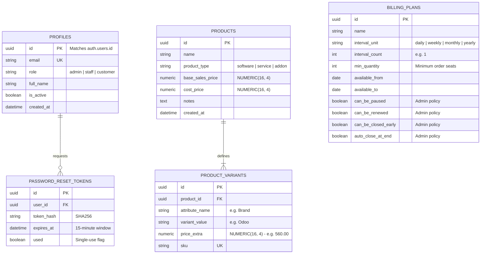

# 🚀 PRD PHASE 1: System Foundation, Identity, Catalog & Billing Plans
## Brightloop Software Subscription Billing Platform (Hackathon Winning Blueprint)

> **Document Version:** 2.0.0 (Next.js 15 + Supabase Architecture)  
> **Engineering Mode:** GRAVITAS Invariant-Enforced Implementation  
> **Tech Stack:** **Next.js 15 (App Router, React 19, TypeScript)** + **Supabase (PostgreSQL 17, RLS, Auth)** + **Tailwind CSS v4** + **Framer Motion / GSAP**  
> **Design Aesthetic:** Premium Obsidian Dark (`#090a0f`) & Crisp Porcelain White (`#ffffff`), Electric Sky Blue Accents (`#0ea5e9` / `#38bdf8`), Tabular Figures, Micro-Glow Cards  
> **Target SLA:** 100% Functional Compliance with Brightloop Problem Statement  
> **Phase Scope:** Core Setup, Identity & RBAC, Product Catalog, Brand Variants (+560 Surcharge), Billing Plans & Policies  

---

## 1. Executive Context & Modern Architecture

Phase 1 establishes the production infrastructure combining **Next.js 15** for full-stack performance with **Supabase** for enterprise-grade PostgreSQL with Row-Level Security (RLS). 

### 1.1 Technology Architecture Matrix
| Layer | Technology | Rationale & Advantage |
| :--- | :--- | :--- |
| **Frontend Framework** | **Next.js 15 (App Router)** | Server Components for instant load, Server Actions for transactional mutations, Client Components for interactive states. |
| **Database & Auth** | **Supabase (PostgreSQL 17)** | ACID compliance, strict `NUMERIC(16, 4)` decimals, Row Level Security (RLS), real-time subscriptions, connection pooling via Supabase pgBouncer. |
| **Styling & Design System**| **Tailwind CSS + Radix UI** | Dark mode (`#090a0f` matte carbon), light mode (`#ffffff`), electric blue buttons (`#0ea5e9`), zero generic template feel. |
| **Animation Engine** | **GSAP / Framer Motion** | Smooth drawer transitions, spotlight card micro-interactions, spring physics for modals. |
| **Data Access Layer** | **`@supabase/ssr` + TypeScript** | End-to-end typed schema definitions, secure server-side session cookies. |

---

## 2. Entity Relationship Diagram (Phase 1 Sub-schema on Supabase)



---

## 3. Detailed Functional Specifications & Business Logic

### 3.1 Authentication & Role-Based Access Control (RBAC)
- **Password Complexity Validator (Server-Side & Client-Side):**
  $$\text{Regex: } ^(?=.*[a-z])(?=.*[A-Z])(?=.*\W).{9,}$$$
  *Guard:* Any password $\le 8$ characters or missing an uppercase letter, lowercase letter, or special character is rejected with HTTP 422.
- **Supabase Row-Level Security (RLS) Policies:**
  - `admin`: Full unrestricted read/write access across all tables.
  - `staff`: Read/write access on quotations and subscriptions; read-only on product catalog; forbidden from provisioning other staff members.
  - `customer`: Strict tenant isolation:
    ```sql
    CREATE POLICY customer_portal_isolation ON subscriptions
    FOR SELECT TO authenticated
    USING (customer_id = auth.uid() OR (SELECT role FROM profiles WHERE id = auth.uid()) IN ('admin', 'staff'));
    ```

### 3.2 Product Variant Pricing Algorithm
When a product variant is selected, its operational price is computed deterministically:
$$\text{Effective Unit Price} = \text{Product.base\_sales\_price} + \sum \text{Variant.price\_extra}$$

*Example from Problem Statement:*
- Product: "Enterprise ERP Software" $\rightarrow$ `base_sales_price = 1200.00`
- Variant: "Brand: Odoo" $\rightarrow$ `price_extra = 560.00`
- Calculated Unit Price = $1200.00 + 560.00 = \mathbf{1760.00}$.

### 3.3 Plan Recurrence & Policy Validation
- A plan can only be assigned to a new subscription if:
  1. `CURRENT_DATE >= available_from` (if set).
  2. `CURRENT_DATE <= available_to` (if set).
  3. Subscription line quantity $\ge$ `plan.min_quantity`.

---

## 4. UI/UX Design System Specification (Phase 1)

### 4.1 Theme Tokens & Visual Hierarchy
- **Dark Mode (Default):**
  - Background Canvas: `#090a0f` (Deep Obsidian / Matte Carbon)
  - Surface Cards: `#11141c` with border `1px solid rgba(255, 255, 255, 0.08)`
  - Primary Action Buttons: Gradient from `#0284c7` to `#0ea5e9` with subtle hover glow `box-shadow: 0 0 20px rgba(14, 165, 233, 0.35)`
  - Text: Primary `#f8fafc`, Secondary `#94a3b8`, Muted `#64748b`
- **Light Mode:**
  - Background Canvas: `#f8fafc` (Soft Cloud Slate)
  - Surface Cards: `#ffffff` with subtle border `#e2e8f0` and soft shadow `0 4px 6px -1px rgba(0, 0, 0, 0.05)`
  - Primary Action Buttons: Solid Royal Sky `#0284c7` hover `#0369a1`
- **Component Micro-Interactions (Framer Motion / GSAP):**
  - Smooth tab switching between **Admin**, **Staff**, and **Customer Portal**.
  - Interactive pricing calculator showing real-time price updates when selecting the `Odoo` brand variant (+560).

---

## 5. API & Server Actions Specification (Next.js 15)

| Route / Server Action | Allowed Roles | Description |
| :--- | :--- | :--- |
| `action: registerCustomer` | Public | Registers customer with strict password regex verification. |
| `action: loginUser` | Public | Authenticates via Supabase Auth & sets secure HTTP-only session cookie. |
| `action: requestPasswordReset` | Public | Generates single-use 15-minute token. |
| `action: resetPasswordWithToken`| Public | Validates token hash and updates password. |
| `action: createStaffMember` | Admin Only | Provisions internal staff account. |
| `action: createProductWithVariants` | Admin Only | Creates product with brand variants and extra surcharges. |
| `action: createBillingPlan` | Admin Only | Configures plan interval and policy toggles. |
| `GET /api/products` | All Authenticated | Returns product catalog with computed variant prices. |

---

## 6. Acceptance Criteria & Gravitas Verification Contract (Phase 1)

- [ ] **AC-1.1:** Attempting to register with password `Pass123` fails with 422 (must be $>8$ chars, uppercase, lowercase, special char).
- [ ] **AC-1.2:** Admin can create a staff member, but a staff member attempting to create another staff member gets HTTP 403 Forbidden.
- [ ] **AC-1.3:** Creating product with base price 1000 and Odoo brand variant with price extra 560 returns effective unit price 1560.
- [ ] **AC-1.4:** Password reset token expires after 15 minutes and cannot be reused twice.
- [ ] **AC-1.5:** Plan with `min_quantity = 5` rejects any order with quantity $< 5$.
- [ ] **AC-1.6:** Next.js UI cleanly toggles between Dark Mode (`#090a0f`) and Light Mode (`#ffffff`) without hydration mismatch.

---
*Signed off for Phase 1 Implementation.*
