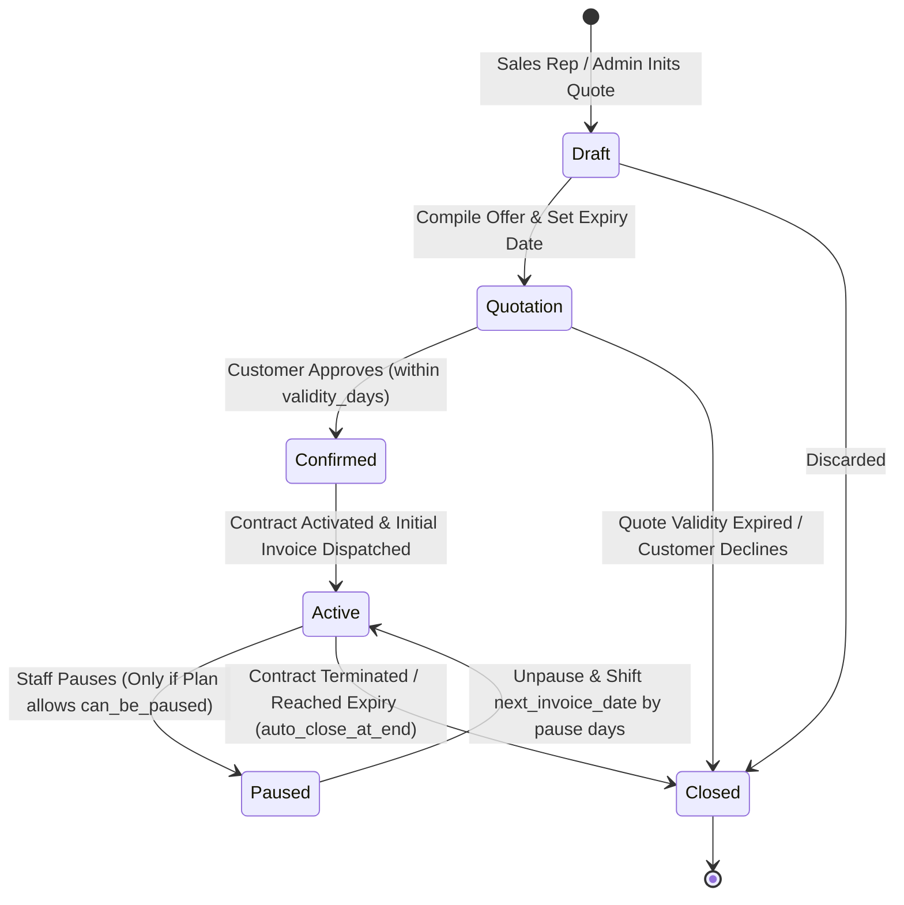

# ⚡ PRD PHASE 2: Quotations, Subscription State Machine & Automated Billing Engine
## Brightloop Software Subscription Billing Platform (Hackathon Winning Blueprint)

> **Document Version:** 1.0.0 (Production Engineering Specification)  
> **Engineering Mode:** GRAVITAS Invariant-Enforced Implementation  
> **Target SLA:** 100% Deterministic Recurring Invoicing (Zero Double-Billing)  
> **Phase Scope:** Quotation Templates, Subscription Lifecycle, Cron Billing Worker, Taxes & Discounts  

---

## 1. Executive Context & Phase Objective

Phase 2 constitutes the operational heart of Brightloop Software. It automates the transition from sales quotes to active recurring contracts, handles hundreds of recurring invoices on billing day without manual labor, enforces tax calculation, and executes dynamic discount rules with atomic decrement locks.

### Core Deliverables in Phase 2
1. **Quotation Templates & Automated Quotation Lifecycle:**
   - Pre-packaged templates linking plans, products, variants, and default quantities.
   - Quotation expiration countdown (`expiry_date = created_at + template.validity_days`).
2. **Robust Subscription State Machine:**
   - Strict 6-state lifecycle: `Draft` $\rightarrow$ `Quotation` $\rightarrow$ `Confirmed` $\rightarrow$ `Active` $\rightarrow$ `Paused` $\rightarrow$ `Closed`.
   - Enforcement of plan policy flags (`can_be_paused`, `auto_close_at_end`, `can_be_closed_early`).
3. **Automated Recurring Billing Engine (The "Billing Day" Solution):**
   - Scheduled background worker scanning `next_invoice_date <= CURRENT_DATE`.
   - Concurrency protection: `SELECT ... FOR UPDATE SKIP LOCKED`.
   - Immutability & double-billing prevention: Deterministic SHA-256 Idempotency Keys.
4. **Dynamic Discount & Tax Engine:**
   - Fixed vs Percentage discounts.
   - Scope: Specific product lines vs entire subscription subtotal.
   - Thresholds: Minimum purchase amount or minimum seats/quantity.
   - Automatic expiration and atomic `max_uses` concurrency protection.
   - Automated tax rule computation on net discounted amounts.
5. **Invoice Management:**
   - State progression: `Draft` $\rightarrow$ `Confirmed` $\rightarrow$ `Paid` / `Cancelled`.
   - Team actions: Confirm, Cancel, Send (email notification), Print (PDF render).

---

## 2. Technical Architecture & Data Models (Phase 2)

### 2.1 Entity Relationship Diagram (Phase 2 Sub-schema)


---

## 3. Subscription State Machine & Business Rules



### 3.1 State Transition Guards
1. **`Draft` $\rightarrow$ `Quotation`:**
   - Validates that lines exist and total seats $\ge$ `plan.min_quantity`.
   - Computes `expiry_date = CURRENT_DATE + template.validity_days`.
2. **`Quotation` $\rightarrow$ `Confirmed`:**
   - **Guard:** `CURRENT_DATE <= expiry_date`. If today is after the expiry date, transition is rejected. Sales rep must re-quote.
3. **`Confirmed` $\rightarrow$ `Active`:**
   - Sets `next_invoice_date = start_date`.
   - Triggers generation of Invoice #1 immediately.
4. **`Active` $\rightarrow$ `Paused`:**
   - **Guard:** `plan.can_be_paused == TRUE`. Rejects if plan policy prohibits pausing.
   - Records `paused_at = CURRENT_TIMESTAMP`.
5. **`Paused` $\rightarrow$ `Active`:**
   - Calculates pause duration: $\Delta t = \text{CURRENT\_DATE} - \text{paused\_at}$.
   - Shifts `next_invoice_date = next_invoice_date + \Delta t`.
   - Shifts `expiry_date = expiry_date + \Delta t` (if applicable).
6. **`Active` $\rightarrow$ `Closed`:**
   - Can be triggered early only if `plan.can_be_closed_early == TRUE`.
   - If `plan.auto_close_at_end == TRUE`, automatically executed by the cron worker when `next_invoice_date >= expiry_date`.

---

## 4. Automated Billing Worker Specification (Cron Engine)

### 4.1 Concurrency & Idempotency Formula
To completely eradicate double billing during mass billing runs:
1. **Locking Query:**
   ```sql
   SELECT id, customer_id, plan_id, next_invoice_date 
   FROM subscriptions 
   WHERE state = 'active' 
     AND next_invoice_date <= CURRENT_DATE 
   FOR UPDATE SKIP LOCKED;
   ```
2. **Deterministic Idempotency Key:**
   $$\text{Idempotency Key} = \text{SHA256}(\text{subscription\_id} + \text{": "} + \text{period\_start} + \text{": "} + \text{period\_end})$$
   A database-level `UNIQUE` constraint on `invoices.idempotency_key` guarantees that even under network partitions or worker crashes, duplicate invoices fail with an explicit integrity violation.

### 4.2 Tax & Discount Ordering Formula
Tax compliance mandates:
$$\text{Gross Subtotal} = \sum (\text{Line.quantity} \times \text{Line.unit\_price})$$
$$\text{Taxable Base} = \max(0, \text{Gross Subtotal} - \text{Discount})$$
$$\text{Tax Amount} = \text{Taxable Base} \times \text{Tax Rate}$$
$$\text{Final Total} = \text{Taxable Base} + \text{Tax Amount}$$

### 4.3 Atomic Discount Usage Lock
To prevent concurrency abuse when a discount has a limit (e.g., first 50 customers):
```sql
UPDATE discount_rules 
SET current_uses = current_uses + 1 
WHERE id = :discount_id 
  AND (max_uses IS NULL OR current_uses < max_uses)
  AND (end_date IS NULL OR end_date >= CURRENT_DATE)
RETURNING id;
```
If 0 rows are returned, the discount is exhausted and must not be applied to the invoice.

---

## 5. API Endpoints Specification (Phase 2)

| Method | Endpoint | Allowed Roles | Description |
| :--- | :--- | :--- | :--- |
| `GET` | `/api/quotation-templates` | Admin, Staff | List quotation templates. |
| `POST` | `/api/quotation-templates` | Admin Only | Create quotation template with product lines. |
| `POST` | `/api/subscriptions` | Staff, Admin | Create new subscription in `draft` state (optionally from template). |
| `POST` | `/api/subscriptions/{id}/transition` | Staff, Admin | Execute validated state transition (`draft` $\rightarrow$ `quotation`, etc.). |
| `POST` | `/api/subscriptions/{id}/pause` | Staff, Admin | Pause subscription (enforces plan policy). |
| `POST` | `/api/subscriptions/{id}/resume` | Staff, Admin | Resume subscription & recalibrate next invoice date. |
| `POST` | `/api/discounts` | Admin Only | Create discount rule (percentage, fixed, thresholds, max uses). |
| `POST` | `/api/invoices/trigger-billing-run` | Admin Only | Manually invoke recurring billing cron cycle. |
| `POST` | `/api/invoices/{id}/confirm` | Staff, Admin | Confirm draft invoice and post to customer ledger. |
| `POST` | `/api/invoices/{id}/cancel` | Staff, Admin | Cancel invoice and void accounting entry. |
| `POST` | `/api/invoices/{id}/send` | Staff, Admin | Dispatch email notification with invoice summary. |
| `GET` | `/api/invoices/{id}/print` | All Authenticated | Render printable invoice artifact. |

---

## 6. Acceptance Criteria & Gravitas Verification Contract (Phase 2)

- [ ] **AC-2.1:** Quote past its validity duration cannot be confirmed (fails with validation error).
- [ ] **AC-2.2:** Subscription on a plan with `can_be_paused = False` fails with HTTP 400 when attempting to pause.
- [ ] **AC-2.3:** Running the billing worker concurrently in 2 threads on 10 due subscriptions produces exactly 10 invoices, never 20.
- [ ] **AC-2.4:** Discount with `max_uses = 1` applied to Invoice #1 is denied on Invoice #2.
- [ ] **AC-2.5:** Tax is calculated strictly on the net discounted amount, not the gross subtotal.

---
*Signed off for Phase 2 Implementation.*
