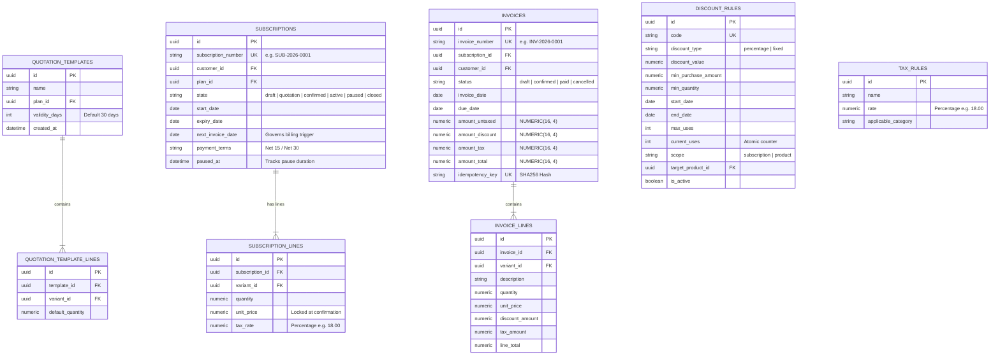
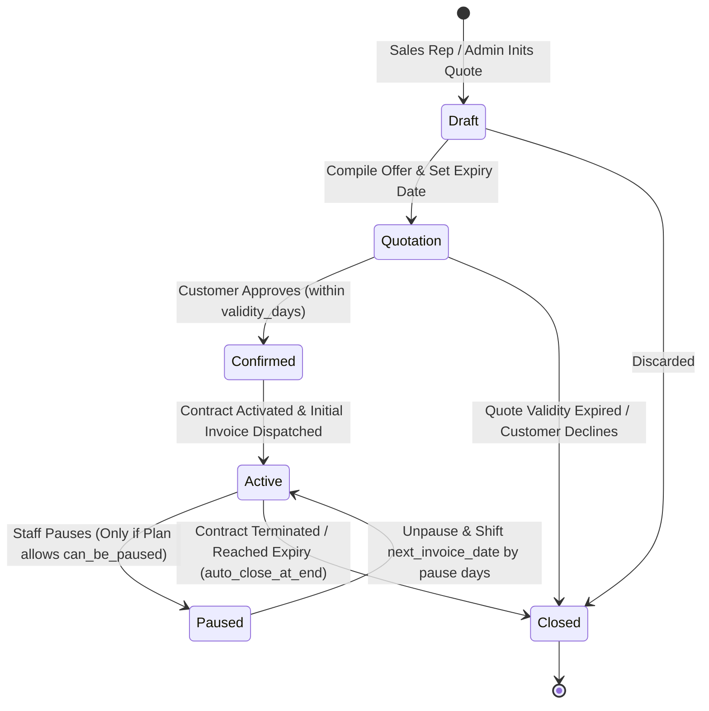

# ⚡ PRD PHASE 2: Quotations, Subscription State Machine & Automated Billing Engine
## Brightloop Software Subscription Billing Platform (Hackathon Winning Blueprint)

> **Document Version:** 2.0.0 (Production Implementation Specification)  
> **Engineering Mode:** GRAVITAS Invariant-Enforced Implementation  
> **Target SLA:** 100% Deterministic Recurring Invoicing (Zero Double-Billing)  
> **Phase Scope:** Quotation Templates, Subscription Lifecycle, Cron Billing Worker, Taxes & Discounts, Step-by-Step Build Plan  

---

## 1. Executive Context & Phase Objective

Phase 2 constitutes the operational heart of Brightloop Software. It automates the transition from sales quotes to active recurring contracts, handles hundreds of recurring invoices on billing day without manual labor, enforces tax calculation, and executes dynamic discount rules with atomic decrement locks.

### Core Deliverables in Phase 2
1. **Quotation Templates & Automated Quotation Lifecycle:**
   - Pre-packaged templates linking plans, products, variants, and default quantities.
   - Quotation expiration countdown (`expiry_date = created_at + template.validity_days`).
2. **Robust Subscription State Machine:**
   - Strict 6-state lifecycle: `Draft` $\rightarrow$ `Quotation` $\rightarrow$ `Confirmed` $\rightarrow$ `Active` $\rightarrow$ `Paused` $\rightarrow$ `Closed`.
   - Enforcement of plan policy flags (`can_be_paused`, `auto_close_at_end`, `can_be_closed_early`).
   - Unique sequential numbering: `SUB-2026-XXXX`.
3. **Automated Recurring Billing Engine (The "Billing Day" Solution):**
   - Scheduled background worker scanning `next_invoice_date <= CURRENT_DATE`.
   - Concurrency protection: `SELECT ... FOR UPDATE SKIP LOCKED` (Postgres) / Transactional Lock (SQLite).
   - Immutability & double-billing prevention: Deterministic SHA-256 Idempotency Keys.
4. **Dynamic Discount & Tax Engine:**
   - Fixed vs Percentage discounts.
   - Scope: Specific product lines vs entire subscription subtotal.
   - Thresholds: Minimum purchase amount or minimum seats/quantity.
   - Proportional tax apportionment across multi-rate tax items.
   - Automatic expiration and atomic `max_uses` concurrency protection.
5. **Invoice Management:**
   - State progression: `Draft` $\rightarrow$ `Confirmed` $\rightarrow$ `Paid` / `Cancelled`.
   - Team actions: Confirm, Cancel, Send (simulated dispatch), Print (PDF / printable layout).

---

## 2. Technical Architecture & Data Models (Phase 2)

### 2.1 Entity Relationship Diagram (Phase 2 Sub-schema)



---

## 3. Subscription State Machine & Business Rules



### 3.1 State Transition Guards
1. **`Draft` $\rightarrow$ `Quotation`:**
   - Validates that lines exist and total seats $\ge$ `plan.min_quantity`.
   - Computes `expiry_date = CURRENT_DATE + template.validity_days`.
2. **`Quotation` $\rightarrow$ `Confirmed`:**
   - **Guard:** `CURRENT_DATE <= expiry_date`. If today is after the expiry date, transition is rejected. Sales rep must re-quote.
3. **`Confirmed` $\rightarrow$ `Active`:**
   - Sets `next_invoice_date = start_date`.
   - Triggers generation of Invoice #1 immediately.
4. **`Active` $\rightarrow$ `Paused`:**
   - **Guard:** `plan.can_be_paused == TRUE`. Rejects if plan policy prohibits pausing.
   - Records `paused_at = CURRENT_TIMESTAMP`.
5. **`Paused` $\rightarrow$ `Active`:**
   - Calculates pause duration: $\Delta t = \text{CURRENT\_DATE} - \text{paused\_at}$.
   - Shifts `next_invoice_date = next_invoice_date + \Delta t`.
   - Shifts `expiry_date = expiry_date + \Delta t` (if applicable).
6. **`Active` $\rightarrow$ `Closed`:**
   - Can be triggered early only if `plan.can_be_closed_early == TRUE`.
   - If `plan.auto_close_at_end == TRUE`, automatically executed by the cron worker when `next_invoice_date >= expiry_date`.

---

## 4. Automated Billing Worker Specification (Cron Engine)

### 4.1 Concurrency & Idempotency Formula
To completely eradicate double billing during mass billing runs:
1. **Locking Query:**
   ```sql
   SELECT id, customer_id, plan_id, next_invoice_date 
   FROM subscriptions 
   WHERE state = 'active' 
     AND next_invoice_date <= CURRENT_DATE 
   FOR UPDATE SKIP LOCKED;
   ```
2. **Deterministic Idempotency Key:**
   $$\text{Idempotency Key} = \text{SHA256}(\text{subscription\_id} + \text{": "} + \text{period\_start} + \text{": "} + \text{period\_end})$$
   A database-level `UNIQUE` constraint on `invoices.idempotency_key` guarantees that even under network partitions or worker crashes, duplicate invoices fail with an explicit integrity violation.

### 4.2 Tax & Discount Ordering Formula (Proportional Apportionment)
When a subscription-level discount applies across multiple items with different tax rates:
1. Compute gross line subtotals: $L_i = Q_i \times P_i$.
2. Compute gross total: $G = \sum L_i$.
3. Compute discount:
   - If percentage: $D_i = L_i \times \frac{\text{discount\_rate}}{100}$.
   - If fixed: $D_i = \text{round}\left(\text{Total Discount} \times \frac{L_i}{G}, 4\right)$.
4. Compute line taxable base: $B_i = \max(0, L_i - D_i)$.
5. Compute line tax: $T_i = B_i \times \frac{\text{Tax Rate}_i}{100}$.
6. Line Total: $TOT_i = B_i + T_i$.
7. Invoice Totals:
   $$\text{amount\_untaxed} = \sum L_i$$
   $$\text{amount\_discount} = \sum D_i$$
   $$\text{amount\_tax} = \sum T_i$$
   $$\text{amount\_total} = \sum TOT_i$$

### 4.3 Atomic Discount Usage Lock
To prevent concurrency abuse when a discount has a limit (e.g., first 50 customers):
```sql
UPDATE discount_rules 
SET current_uses = current_uses + 1 
WHERE id = :discount_id 
  AND (max_uses IS NULL OR current_uses < max_uses)
  AND (end_date IS NULL OR end_date >= CURRENT_DATE)
RETURNING id;
```
If 0 rows are returned, the discount is exhausted and must not be applied to the invoice.

---

## 5. End-to-End Implementation Plan (Phase 2)

### Step 2.1: Quotation Template Engine
- Implement `models/quotation_template.py` linking template header and child lines.
- Implement `services/quotation_service.py`:
  - `create_quotation_from_template(template_id, customer_id)`: clones lines, sets default terms, calculates `expiry_date = today + validity_days`.
  - Generates unique sequence number: `SUB-2026-XXXX`.

### Step 2.2: State Machine Implementation
- Implement `core/state_machine.py`:
  - State transition validator enforcing legal pathways.
  - Guard checks: validity date on confirmation, `can_be_paused` flag on pause, `can_be_closed_early` on cancellation.
  - Pause duration tracking with automatic date recalibration upon resumption.

### Step 2.3: Tax & Dynamic Discount Engine
- Implement `services/tax_service.py` to retrieve tax rules by product category.
- Implement `services/discount_service.py`:
  - Evaluates start/end date, min purchase amount, min quantity, and remaining usage capacity.
  - Implements proportional discount apportionment formula across line items.
  - Manages atomic increment of `current_uses`.

### Step 2.4: Mass Invoicing Background Worker
- Implement `workers/billing_worker.py`:
  - Scans active subscriptions where `next_invoice_date <= CURRENT_DATE`.
  - Generates SHA-256 idempotency key: `SHA256(sub_id + str(period_start) + str(period_end))`.
  - Atomically creates `Invoice` in `draft` state and advances subscription `next_invoice_date` according to plan frequency (`daily`, `weekly`, `monthly`, `yearly`).
  - Provides manual trigger endpoint for admin testing: `POST /api/invoices/trigger-billing-run`.

### Step 2.5: Invoice Management & Actions
- Implement `services/invoice_service.py`:
  - State transitions: `draft` $\rightarrow$ `confirmed` $\rightarrow$ `paid` / `cancelled`.
  - Actions: Confirm, Cancel, Send (simulated dispatch), Print (HTML printable template).

### Step 2.6: Verification & Automated Tests
- Create `tests/test_phase2_billing_engine.py`:
  - Test 1: Quotation expiration guard (quote past expiry date cannot be confirmed).
  - Test 2: State machine pause guard (plan with `can_be_paused=False` rejects pause).
  - Test 3: Idempotent billing run (triggering billing 5 times generates exactly 1 invoice per due subscription).
  - Test 4: Dynamic discount auto-expiry and max uses exhaustion.
  - Test 5: Tax calculation order-of-operations (taxes applied to net discounted amount).

### Step 2.7: Git Commit Milestone
- Run test suite: `pytest tests/test_phase2_billing_engine.py -v`.
- Commit message: `feat(phase2): implement quotation lifecycle, subscription state machine, automated billing worker, taxes, and dynamic discounts`.

---

## 6. Acceptance Criteria & Gravitas Verification Contract (Phase 2)

- [ ] **AC-2.1:** Quote past its validity duration cannot be confirmed (fails with validation error).
- [ ] **AC-2.2:** Subscription on a plan with `can_be_paused = False` fails with HTTP 400 when attempting to pause.
- [ ] **AC-2.3:** Running the billing worker concurrently in 2 threads on 10 due subscriptions produces exactly 10 invoices, never 20.
- [ ] **AC-2.4:** Discount with `max_uses = 1` applied to Invoice #1 is denied on Invoice #2.
- [ ] **AC-2.5:** Tax is calculated strictly on the net discounted amount, not the gross subtotal.

---
*Signed off for Phase 2 Implementation.*
