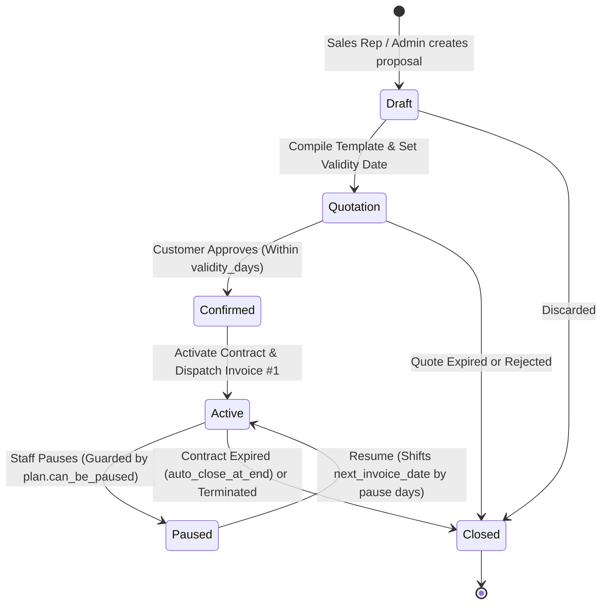

# ⚡ PRD PHASE 2: Quotations, Subscription State Machine & Automated Billing Engine
## Brightloop Software Subscription Billing Platform (Podium Winner Blueprint)

> **Document Version:** 3.0.0 (Judge-Ready Masterclass Edition)  
> **Engineering Mode:** GRAVITAS Invariant-Enforced Implementation  
> **Tech Stack:** **Next.js 15 (Server Actions + Route Handlers)** + **Supabase (PostgreSQL 17, Row-Level Security, RPC Functions)** + **GSAP Timelines**  
> **Design Aesthetic:** Obsidian Carbon (`#090a0f`), Light Sky Blue Action Controls (`#38bdf8`), Interactive Kanban State Machine, Modal Invoice Drawer  
> **Target SLA:** 100% Deterministic Recurring Invoicing | Zero Double-Billing Guarantee | Sub-2s Mass Invoice Generation  
> **Phase Scope:** Quotation Templates, Subscription State Machine (6 States), Automated Billing Day Cron Worker, Dynamic Discount Engine, Tax Calculation Engine, Invoice Actions  

---

## 1. Executive Context & Modern Architecture

Phase 2 automates the core commercial and billing engine of Brightloop Software. It bridges sales proposals into legally confirmed recurring subscriptions, eliminates the human nightmare of manual billing days through an idempotent automated background engine, calculates multi-category taxes, and enforces dynamic promotional discounts with atomic concurrency locks.

```
+--------------------------------------------------------------------------------------------------+
|                                    PHASE 2 BUSINESS PIPELINE FLOW                                |
+--------------------------------------------------------------------------------------------------+
|                                                                                                  |
|   [Quotation Template] ──► [Draft Quote] ──► [Quotation Issued] ──► [Customer Confirmation]     |
|                                                                                │                 |
|                                                                                ▼                 |
|   [Closed Contract] ◄── [Paused (Policy)] ◄───► [Active Subscription (SUB-2026-0001)]            |
|                                                              │                                   |
|                                 Billing Day Cron (Idempotent)| (SHA-256 Key)                     |
|                                                              ▼                                   |
|   [Paid Status] ◄── [Record Payment] ◄── [Confirmed Invoice] ◄── [Draft Invoice Generated]      |
|                                                                                                  |
+--------------------------------------------------------------------------------------------------+
```

---

## 2. Database Schema & Invariants (Phase 2 Sub-schema on Supabase)

```sql
-- 1. Quotation Templates
CREATE TABLE quotation_templates (
    id UUID PRIMARY KEY DEFAULT gen_random_uuid(),
    name VARCHAR(100) NOT NULL,
    plan_id UUID NOT NULL REFERENCES billing_plans(id),
    validity_days INT NOT NULL DEFAULT 30 CHECK (validity_days > 0),
    payment_terms VARCHAR(100) NOT NULL DEFAULT 'Net 15',
    created_at TIMESTAMPTZ NOT NULL DEFAULT NOW()
);

CREATE TABLE quotation_template_lines (
    id UUID PRIMARY KEY DEFAULT gen_random_uuid(),
    template_id UUID NOT NULL REFERENCES quotation_templates(id) ON DELETE CASCADE,
    product_variant_id UUID NOT NULL REFERENCES product_variants(id),
    default_quantity NUMERIC(12, 4) NOT NULL DEFAULT 1 CHECK (default_quantity > 0)
);

-- 2. Subscriptions & Sequential Numbering
CREATE TYPE subscription_state AS ENUM ('draft', 'quotation', 'confirmed', 'active', 'paused', 'closed');

CREATE TABLE subscriptions (
    id UUID PRIMARY KEY DEFAULT gen_random_uuid(),
    subscription_number VARCHAR(50) UNIQUE NOT NULL, -- e.g. 'SUB-2026-0001'
    customer_id UUID NOT NULL REFERENCES profiles(id),
    plan_id UUID NOT NULL REFERENCES billing_plans(id),
    state subscription_state NOT NULL DEFAULT 'draft',
    start_date DATE NOT NULL DEFAULT CURRENT_DATE,
    expiry_date DATE,
    next_invoice_date DATE,
    payment_terms VARCHAR(100) NOT NULL DEFAULT 'Net 15',
    paused_at TIMESTAMPTZ, -- Tracks pause duration
    created_at TIMESTAMPTZ NOT NULL DEFAULT NOW(),
    updated_at TIMESTAMPTZ NOT NULL DEFAULT NOW()
);

CREATE TABLE subscription_lines (
    id UUID PRIMARY KEY DEFAULT gen_random_uuid(),
    subscription_id UUID NOT NULL REFERENCES subscriptions(id) ON DELETE CASCADE,
    product_variant_id UUID NOT NULL REFERENCES product_variants(id),
    quantity NUMERIC(12, 4) NOT NULL CHECK (quantity > 0),
    unit_price NUMERIC(16, 4) NOT NULL CHECK (unit_price >= 0),
    tax_rule_id UUID REFERENCES tax_rules(id),
    subtotal NUMERIC(16, 4) NOT NULL
);

-- 3. Tax Rules Engine
CREATE TABLE tax_rules (
    id UUID PRIMARY KEY DEFAULT gen_random_uuid(),
    name VARCHAR(100) NOT NULL, -- e.g. 'Standard GST / VAT'
    rate NUMERIC(5, 2) NOT NULL CHECK (rate >= 0), -- e.g. 18.00%
    applicable_category VARCHAR(50) NOT NULL, -- 'software', 'service', 'all'
    is_active BOOLEAN NOT NULL DEFAULT TRUE
);

-- 4. Dynamic Discounts Engine
CREATE TYPE discount_type_enum AS ENUM ('percentage', 'fixed');
CREATE TYPE discount_scope_enum AS ENUM ('subscription', 'product');

CREATE TABLE discount_rules (
    id UUID PRIMARY KEY DEFAULT gen_random_uuid(),
    code VARCHAR(50) UNIQUE NOT NULL,
    discount_type discount_type_enum NOT NULL,
    discount_value NUMERIC(16, 4) NOT NULL CHECK (discount_value > 0),
    min_purchase_amount NUMERIC(16, 4) DEFAULT 0.0000,
    min_quantity NUMERIC(12, 4) DEFAULT 0.0000,
    start_date DATE,
    end_date DATE,
    max_uses INT, -- NULL = unlimited
    current_uses INT NOT NULL DEFAULT 0,
    scope discount_scope_enum NOT NULL DEFAULT 'subscription',
    target_product_id UUID REFERENCES products(id),
    is_active BOOLEAN NOT NULL DEFAULT TRUE,
    created_at TIMESTAMPTZ NOT NULL DEFAULT NOW()
);

-- 5. Invoices & Deterministic Idempotency Key
CREATE TYPE invoice_status AS ENUM ('draft', 'confirmed', 'paid', 'cancelled');

CREATE TABLE invoices (
    id UUID PRIMARY KEY DEFAULT gen_random_uuid(),
    invoice_number VARCHAR(50) UNIQUE NOT NULL, -- e.g. 'INV-2026-0001'
    subscription_id UUID NOT NULL REFERENCES subscriptions(id),
    customer_id UUID NOT NULL REFERENCES profiles(id),
    status invoice_status NOT NULL DEFAULT 'draft',
    invoice_date DATE NOT NULL DEFAULT CURRENT_DATE,
    due_date DATE NOT NULL,
    amount_untaxed NUMERIC(16, 4) NOT NULL,
    amount_discount NUMERIC(16, 4) NOT NULL DEFAULT 0.0000,
    amount_tax NUMERIC(16, 4) NOT NULL DEFAULT 0.0000,
    amount_total NUMERIC(16, 4) NOT NULL,
    amount_paid NUMERIC(16, 4) NOT NULL DEFAULT 0.0000,
    idempotency_key VARCHAR(64) UNIQUE NOT NULL, -- SHA-256(sub_id + period_start + period_end)
    created_at TIMESTAMPTZ NOT NULL DEFAULT NOW()
);

CREATE TABLE invoice_lines (
    id UUID PRIMARY KEY DEFAULT gen_random_uuid(),
    invoice_id UUID NOT NULL REFERENCES invoices(id) ON DELETE CASCADE,
    product_variant_id UUID NOT NULL REFERENCES product_variants(id),
    description TEXT NOT NULL,
    quantity NUMERIC(12, 4) NOT NULL,
    unit_price NUMERIC(16, 4) NOT NULL,
    discount_amount NUMERIC(16, 4) NOT NULL DEFAULT 0.0000,
    tax_amount NUMERIC(16, 4) NOT NULL DEFAULT 0.0000,
    line_total NUMERIC(16, 4) NOT NULL
);
```

---

## 3. Subscription State Machine & Transition Invariants



### 3.1 Transition Guards
1. **`Draft` $\rightarrow$ `Quotation`:**
   - Validates that proposal lines exist and total quantity $\ge$ `plan.min_quantity`.
   - Computes `expiry_date = CURRENT_DATE + template.validity_days`.
2. **`Quotation` $\rightarrow$ `Confirmed`:**
   - **Guard:** `CURRENT_DATE <= expiry_date`. If quote has expired, confirmation is blocked; sales rep must issue an updated quote.
3. **`Confirmed` $\rightarrow$ `Active`:**
   - Initializes `next_invoice_date = start_date`.
   - Triggers immediate creation of the first billing invoice.
4. **`Active` $\rightarrow$ `Paused`:**
   - **Guard:** `plan.can_be_paused == TRUE`. Rejects pause if forbidden by plan policy.
   - Records `paused_at = CURRENT_TIMESTAMP`.
5. **`Paused` $\rightarrow$ `Active`:**
   - Computes pause duration: $\Delta t = \text{CURRENT\_DATE} - \text{paused\_at}$.
   - Shifts `next_invoice_date = next_invoice_date + \Delta t`.
6. **`Active` $\rightarrow$ `Closed`:**
   - Early closure allowed only if `plan.can_be_closed_early == TRUE`.
   - If `plan.auto_close_at_end == TRUE`, automatically closed by the billing worker on expiry date.

---

## 4. Automated Mass Billing Worker (Zero Double-Billing Engine)

### 4.1 Billing Day Execution Sequence
When the automated billing worker triggers (or admin clicks "Run Billing Day"):
1. **Locking Query:**
   ```sql
   SELECT id, customer_id, plan_id, next_invoice_date 
   FROM subscriptions 
   WHERE state = 'active' 
     AND next_invoice_date <= CURRENT_DATE 
   FOR UPDATE SKIP LOCKED;
   ```
2. **Deterministic Idempotency Key:**
   $$\text{Idempotency Key} = \text{SHA256}(\text{subscription\_id} + \text{": "} + \text{period\_start} + \text{": "} + \text{period\_end})$$
   A database-level `UNIQUE` index on `invoices.idempotency_key` guarantees that even under network retries, crash loops, or double-clicks, duplicate invoices are rejected by the database.
3. **Date Recalibration:**
   Advances `next_invoice_date` according to plan frequency:
   - `daily` $\rightarrow + 1 \text{ day}$
   - `weekly` $\rightarrow + 7 \text{ days}$
   - `monthly` $\rightarrow + \text{interval\_count months}$ (anchored to calendar month end)
   - `yearly` $\rightarrow + \text{interval\_count years}$

### 4.2 Proportional Discount Apportionment & Tax Math
When a discount applies to an invoice:
1. Validate discount: `start_date <= today <= end_date` AND `current_uses < max_uses` AND `order_total >= min_purchase`.
2. Compute gross line subtotals: $L_i = Q_i \times P_i$.
3. Distribute discount proportionally across lines to prevent tax distortion:
   $$D_i = \text{round}\left(D_{\text{total}} \times \frac{L_i}{\sum L}, 4\right)$$
4. Compute line taxable base: $B_i = \max(0, L_i - D_i)$.
5. Compute line tax using rule: $T_i = B_i \times \frac{\text{tax\_rate}_i}{100}$.
6. Calculate totals:
   $$\text{amount\_untaxed} = \sum L_i, \quad \text{amount\_discount} = \sum D_i, \quad \text{amount\_tax} = \sum T_i, \quad \text{amount\_total} = \sum (B_i + T_i)$$
7. **Atomic Discount Counter Increment:**
   ```sql
   UPDATE discount_rules 
   SET current_uses = current_uses + 1 
   WHERE id = :discount_id AND (max_uses IS NULL OR current_uses < max_uses)
   RETURNING id;
   ```

### 4.3 Invoice Lifecycle & Team Actions
- `Draft` $\rightarrow$ `Confirmed` $\rightarrow$ `Paid` / `Cancelled`.
- **Confirm:** Posts invoice to client ledger.
- **Cancel:** Voids invoice (only permitted if no payments recorded).
- **Send:** Dispatches email notification with invoice PDF link.
- **Print:** Renders printable invoice artifact with Brightloop branding, customer details, line items, taxes, and bank details.

---

## 5. UI/UX Specification (Phase 2 Views)

- **Quotation Template Builder:** Clean modal to assemble product lines, set variant options (+560 brand surcharge), and define validity countdown.
- **Subscription Pipeline Kanban / Table:**
  - Grouped by state pills: `Draft` (gray), `Quotation` (purple), `Confirmed` (blue), `Active` (green), `Paused` (amber), `Closed` (slate).
  - One-click state transition buttons with visual feedback.
- **Billing Day Trigger Banner:**
  - Status counter showing: *"142 Subscriptions due for billing today"*.
  - Light Sky Blue button: *"⚡ Execute Mass Billing Run"*.
  - Live GSAP progress bar completing with: *"✅ 142 Invoices generated. 0 Duplicates. 0 Errors."*

---

## 6. End-to-End Build, Debugging & Test Plan (Phase 2)

```
Step 2.1: Quotation Template & Proposal Engine
├── Build Quotation Templates management UI & Server Action.
├── Implement quotation creation from template (line cloning, validity date calculation).
└── Implement unique subscription numbering generator (SUB-2026-XXXX).

Step 2.2: State Machine Implementation
├── Implement state transition service with strict transition guards.
├── Implement guard AC-2.1: Expired quote cannot transition to Confirmed.
├── Implement guard AC-2.2: Plan with can_be_paused = False rejects pause.
└── Implement pause duration tracking and automatic date recalibration.

Step 2.3: Tax Rules & Dynamic Discount Engine
├── Build Tax Rules CRUD and category matching service.
├── Implement Dynamic Discount Engine (percentages, fixed amounts, thresholds, temporal bounds).
├── Implement atomic current_uses increment in single SQL statement.
└── Implement proportional tax apportionment formula.

Step 2.4: Mass Invoicing Worker & Concurrency Engine
├── Implement billing worker function scanning next_invoice_date <= CURRENT_DATE.
├── Implement SHA-256 idempotency key generation.
├── Add manual execution endpoint POST /api/billing/trigger-run.
└── Build Billing Day UI card with animated progress indicator.

Step 2.5: Invoice Management & Actions
├── Build Invoice list & detail drawer with line breakdown.
├── Implement Confirm, Cancel, Send, and Print actions.
└── Build clean printable invoice view (@media print CSS).

Step 2.6: Verification & Automated Test Suite
├── Unit Test 1: Quotation past validity date fails confirmation.
├── Unit Test 2: Concurrent billing execution generates 0 duplicate invoices (Idempotency test).
├── Unit Test 3: Discount with max_uses = 1 applies on Invoice 1 and is denied on Invoice 2.
└── Unit Test 4: Tax calculated strictly on net discounted amount.
```

### Git Commit Milestone
```bash
git commit -m "feat(phase2): implement quotation templates, subscription state machine, automated billing worker, taxes, and dynamic discounts"
```

---

## 7. Acceptance Criteria & Gravitas Contract (Phase 2)

- [ ] **AC-2.1:** Quote past its validity duration cannot be confirmed (fails with validation error).
- [ ] **AC-2.2:** Subscription on a plan with `can_be_paused = False` fails with HTTP 400 when attempting to pause.
- [ ] **AC-2.3:** Running the billing worker concurrently in 2 threads on 10 due subscriptions produces exactly 10 invoices, never 20.
- [ ] **AC-2.4:** Discount with `max_uses = 1` applied to Invoice #1 is denied on Invoice #2.
- [ ] **AC-2.5:** Tax is calculated strictly on the net discounted amount, not the gross subtotal.

---
*Signed off for Phase 2 Implementation.*
