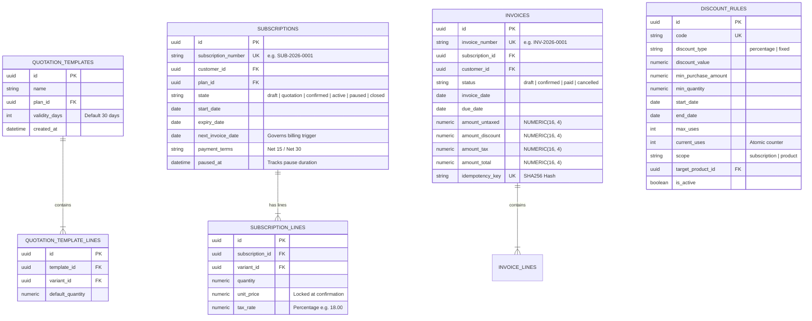
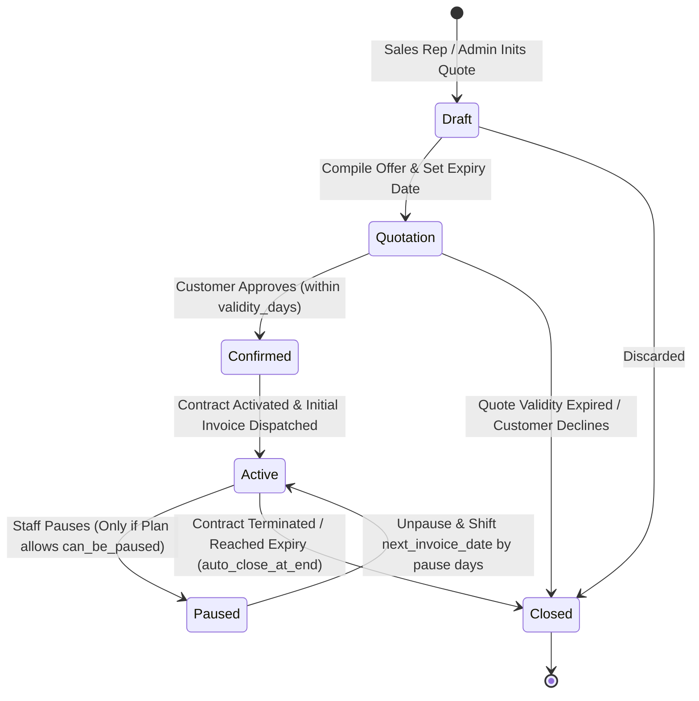

# ⚡ PRD PHASE 2: Quotations, Subscription State Machine & Automated Billing Engine
## Brightloop Software Subscription Billing Platform (Hackathon Winning Blueprint)

> **Document Version:** 2.0.0 (Next.js 15 + Supabase Architecture)  
> **Engineering Mode:** GRAVITAS Invariant-Enforced Implementation  
> **Tech Stack:** **Next.js 15 (Server Actions + Route Handlers)** + **Supabase (PostgreSQL 17 Functions & Cron)**  
> **Target SLA:** 100% Deterministic Recurring Invoicing (Zero Double-Billing)  
> **Phase Scope:** Quotation Templates, Subscription Lifecycle, Automated Billing Cron, Dynamic Discounts & Taxes  

---

## 1. Executive Context & Modern Architecture

Phase 2 automates the transition from sales quotes to active recurring contracts, handles hundreds of recurring invoices on billing day without manual labor, enforces tax calculation, and executes dynamic discount rules with atomic decrement locks.

### 1.1 Technology Architecture Matrix
| Component | Implementation | Invariant Guarantee |
| :--- | :--- | :--- |
| **State Machine Transitions** | Next.js Server Actions with Supabase ACID Transactions | Guaranteed atomic state transitions (`Draft` $\rightarrow$ `Quotation` $\rightarrow$ `Confirmed` $\rightarrow$ `Active` $\rightarrow$ `Paused` $\rightarrow$ `Closed`). |
| **Billing Worker Engine** | Next.js API Route `/api/cron/billing-run` secured with `CRON_SECRET` + Supabase SQL Function with `SKIP LOCKED` | Immune to cron overlap; immune to double-billing via deterministic SHA-256 idempotency key. |
| **Discount Atomic Engine** | PostgreSQL single-statement conditional update | Prevents concurrency exploitation on limited-use promotion rules. |
| **Invoice Render & Export** | Next.js Dynamic Printable View (`@react-pdf/renderer` or `@media print` CSS) | Formats invoices into professional printable PDF artifacts with customer & line breakdowns. |

---

## 2. Entity Relationship Diagram (Phase 2 Sub-schema on Supabase)



---

## 3. Subscription State Machine & Business Rules



### 3.1 State Transition Guards
1. **`Draft` $\rightarrow$ `Quotation`:**
   - Validates that lines exist and total seats $\ge$ `plan.min_quantity`.
   - Computes `expiry_date = CURRENT_DATE + template.validity_days`.
2. **`Quotation` $\rightarrow$ `Confirmed`:**
   - **Guard:** `CURRENT_DATE <= expiry_date`. If today is after the expiry date, transition is rejected. Sales rep must re-quote.
3. **`Confirmed` $\rightarrow$ `Active`:**
   - Sets `next_invoice_date = start_date`.
   - Triggers generation of Invoice #1 immediately.
4. **`Active` $\rightarrow$ `Paused`:**
   - **Guard:** `plan.can_be_paused == TRUE`. Rejects if plan policy prohibits pausing.
   - Records `paused_at = CURRENT_TIMESTAMP`.
5. **`Paused` $\rightarrow$ `Active`:**
   - Calculates pause duration: $\Delta t = \text{CURRENT\_DATE} - \text{paused\_at}$.
   - Shifts `next_invoice_date = next_invoice_date + \Delta t`.
   - Shifts `expiry_date = expiry_date + \Delta t` (if applicable).
6. **`Active` $\rightarrow$ `Closed`:**
   - Can be triggered early only if `plan.can_be_closed_early == TRUE`.
   - If `plan.auto_close_at_end == TRUE`, automatically executed by the cron worker when `next_invoice_date >= expiry_date`.

---

## 4. Automated Billing Worker Specification (Cron Engine)

### 4.1 Concurrency & Idempotency Formula
To completely eradicate double billing during mass billing runs:
1. **Locking Query on Supabase PostgreSQL:**
   ```sql
   SELECT id, customer_id, plan_id, next_invoice_date 
   FROM subscriptions 
   WHERE state = 'active' 
     AND next_invoice_date <= CURRENT_DATE 
   FOR UPDATE SKIP LOCKED;
   ```
2. **Deterministic Idempotency Key:**
   $$\text{Idempotency Key} = \text{SHA256}(\text{subscription\_id} + \text{": "} + \text{period\_start} + \text{": "} + \text{period\_end})$$
   A database-level `UNIQUE` constraint on `invoices.idempotency_key` guarantees that even under network partitions or worker crashes, duplicate invoices fail with an explicit integrity violation.

### 4.2 Tax & Discount Ordering Formula
Tax compliance mandates:
$$\text{Gross Subtotal} = \sum (\text{Line.quantity} \times \text{Line.unit\_price})$$
$$\text{Taxable Base} = \max(0, \text{Gross Subtotal} - \text{Discount})$$
$$\text{Tax Amount} = \text{Taxable Base} \times \text{Tax Rate}$$
$$\text{Final Total} = \text{Taxable Base} + \text{Tax Amount}$$

### 4.3 Atomic Discount Usage Lock
To prevent concurrency abuse when a discount has a limit (e.g., first 50 customers):
```sql
UPDATE discount_rules 
SET current_uses = current_uses + 1 
WHERE id = :discount_id 
  AND (max_uses IS NULL OR current_uses < max_uses)
  AND (end_date IS NULL OR end_date >= CURRENT_DATE)
RETURNING id;
```
If 0 rows are returned, the discount is exhausted and must not be applied to the invoice.

---

## 5. UI/UX Workflow & Component Specification (Next.js 15)

1. **Quotation Builder Interface:**
   - Sales reps select a template dropdown $\rightarrow$ auto-populates product lines with brand variant options.
   - Interactive badge displaying days remaining until quotation expiration.
2. **Subscription Management Table:**
   - Status pill badges with distinctive glow:
     - `Active`: Emerald green (`bg-emerald-500/10 text-emerald-400 border border-emerald-500/20`)
     - `Quotation`: Amber (`bg-amber-500/10 text-amber-400 border border-amber-500/20`)
     - `Paused`: Violet (`bg-purple-500/10 text-purple-400 border border-purple-500/20`)
     - `Closed`: Slate (`bg-slate-500/10 text-slate-400 border border-slate-500/20`)
   - Action buttons (Confirm, Pause, Cancel, Trigger Bill) with micro-tooltips.
3. **Invoice Viewer & PDF Print:**
   - Clean modal view displaying line items, brand variant pricing (+560 extra), tax breakdown, and discount lines.
   - Instant `@media print` button to generate a clean client-ready PDF invoice.

---

## 6. API & Server Actions Specification (Phase 2)

| Route / Server Action | Allowed Roles | Description |
| :--- | :--- | :--- |
| `action: createQuotationTemplate` | Admin Only | Configures pre-packaged quotation template. |
| `action: createSubscription` | Staff, Admin | Initializes draft subscription from scratch or template. |
| `action: transitionSubscription` | Staff, Admin | Executes state change with strict guard checks. |
| `action: pauseSubscription` | Staff, Admin | Pauses subscription if plan allows `can_be_paused`. |
| `action: resumeSubscription` | Staff, Admin | Resumes subscription and shifts next invoice date. |
| `action: createDiscountRule` | Admin Only | Defines percentage/fixed discount with thresholds and limits. |
| `POST /api/cron/billing` | System / Admin | Executes scheduled recurring billing cycle with `SKIP LOCKED`. |
| `action: confirmInvoice` | Staff, Admin | Confirms draft invoice and posts to customer ledger. |
| `action: cancelInvoice` | Staff, Admin | Cancels and voids an uncollected invoice. |

---

## 7. Acceptance Criteria & Gravitas Verification Contract (Phase 2)

- [ ] **AC-2.1:** Quote past its validity duration cannot be confirmed (fails with validation error).
- [ ] **AC-2.2:** Subscription on a plan with `can_be_paused = False` fails with HTTP 400 when attempting to pause.
- [ ] **AC-2.3:** Running the billing worker concurrently in 2 threads on 10 due subscriptions produces exactly 10 invoices, never 20.
- [ ] **AC-2.4:** Discount with `max_uses = 1` applied to Invoice #1 is denied on Invoice #2.
- [ ] **AC-2.5:** Tax is calculated strictly on the net discounted amount, not the gross subtotal.

---
*Signed off for Phase 2 Implementation.*
