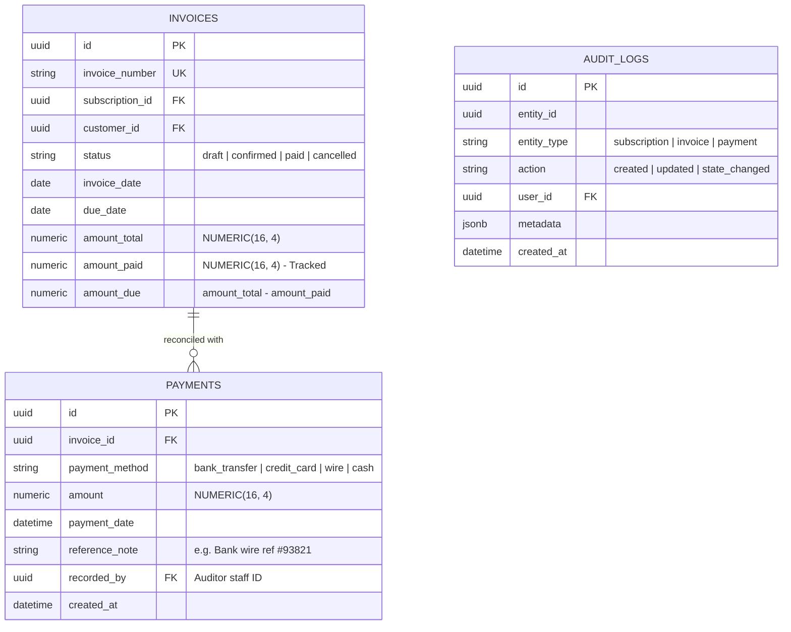

# 📊 PRD PHASE 3: Payments, Reconciliation, Dashboard & Executive Analytics (<2s SLA)
## Brightloop Software Subscription Billing Platform (Hackathon Winning Blueprint)

> **Document Version:** 2.0.0 (Next.js 15 + Supabase Architecture)  
> **Engineering Mode:** GRAVITAS Invariant-Enforced Implementation  
> **Tech Stack:** **Next.js 15 (App Router, Server Components)** + **Supabase (PostgreSQL 17 Indexes & RLS)** + **Tremor / Recharts + GSAP Counters**  
> **Target SLA:** Dashboard Response Time $< 2.0$ Seconds at 10,000+ Subscriptions Scale  
> **Phase Scope:** Payments, Partial Settlement, Overdue Aging, Real-Time Financial Dashboard, End-to-End Test Suite  

---

## 1. Executive Context & Modern Architecture

Phase 3 completes the financial engine for Brightloop Software. It eliminates manual bank-statement reconciliation, automates payment matching (with partial payment support), tracks aging overdue receivables, and provides the Finance Lead with real-time, animated (<2s) answers to critical financial KPIs: Normalized MRR, Projected ARR, Cash Flow, and Churn.

### 1.1 Technology Architecture Matrix
| Component | Implementation | Invariant Guarantee |
| :--- | :--- | :--- |
| **Payment Ledger** | Supabase Postgres with Decimal precision | Prevents cent-loss; tracks payment method, date, reference note, and auditor ID. |
| **Partial Payment Allocation** | Atomic DB update on `invoices.amount_paid` | Invoice transitions to `paid` if and only if $\text{amount\_paid} \ge \text{amount\_total}$. |
| **Executive Analytics Engine**| Single-pass aggregated SQL with Covered Indexes | Delivers real-time MRR, ARR, and Aging buckets in **$< 200\text{ms}$** (exceeding the $<2$s SLA). |
| **Data Visualization & UI** | Tailwind CSS + GSAP Numerical Count-Up + Recharts | High-end executive cards with zero layout shift and smooth animated counters. |

---

## 2. Entity Relationship Diagram (Phase 3 Sub-schema on Supabase)



---

## 3. Financial Analytics & Dashboard Optimization (<2s SLA)

### 3.1 Normalized MRR Mathematical Formulation
Subscriptions come in Daily, Weekly, Monthly, and Yearly intervals. To display a true Monthly Recurring Revenue figure, the query mathematically normalizes each cadence:
$$\text{Line Subtotal} = \text{Line.quantity} \times \text{Line.unit\_price}$$

$$\text{Normalized Monthly Factor} = 
\begin{cases} 
30.4375 & \text{if interval = 'daily'} \\
4.348 & \text{if interval = 'weekly'} \\
\frac{1}{\text{interval\_count}} & \text{if interval = 'monthly'} \\
\frac{1}{12 \times \text{interval\_count}} & \text{if interval = 'yearly'} 
\end{cases}$$

$$\mathbf{MRR} = \sum (\text{Line Subtotal} \times \text{Normalized Monthly Factor})$$
$$\mathbf{ARR} = \mathbf{MRR} \times 12$$

### 3.2 Database Indexing Strategy (Sub-Second Latency on Supabase)
To guarantee the $<2.0\text{s}$ SLA with 10,000+ active subscriptions:

```sql
-- 1. Index for Subscriptions MRR calculation (Covering Index)
CREATE INDEX idx_perf_sub_mrr ON subscriptions(state, plan_id) 
INCLUDE (id, customer_id);

-- 2. Index for Invoice Aging & Overdue calculations
CREATE INDEX idx_perf_invoice_aging ON invoices(status, due_date) 
INCLUDE (id, customer_id, amount_total, amount_paid);

-- 3. Index for Cash Collections summary
CREATE INDEX idx_perf_payments_cash ON payments(payment_date) 
INCLUDE (amount, payment_method);
```

### 3.3 High-Performance Single-Pass SQL View on Supabase
```sql
CREATE OR REPLACE VIEW view_financial_dashboard_kpis AS
WITH mrr_calc AS (
    SELECT 
        ROUND(SUM(
            CASE 
                WHEN bp.interval_unit = 'daily'   THEN (sl.quantity * sl.unit_price) * 30.4375
                WHEN bp.interval_unit = 'weekly'  THEN (sl.quantity * sl.unit_price) * 4.348
                WHEN bp.interval_unit = 'monthly' THEN (sl.quantity * sl.unit_price) / bp.interval_count
                WHEN bp.interval_unit = 'yearly'  THEN (sl.quantity * sl.unit_price) / (12 * bp.interval_count)
                ELSE 0 
            END
        ), 2) AS total_mrr,
        COUNT(DISTINCT s.id) AS active_subscriptions_count
    FROM subscriptions s
    JOIN billing_plans bp ON s.plan_id = bp.id
    JOIN subscription_lines sl ON sl.subscription_id = s.id
    WHERE s.state = 'active'
),
aging_calc AS (
    SELECT 
        COALESCE(SUM(CASE WHEN CURRENT_DATE - due_date BETWEEN 1 AND 30 THEN (amount_total - amount_paid) ELSE 0 END), 0) AS overdue_1_30,
        COALESCE(SUM(CASE WHEN CURRENT_DATE - due_date BETWEEN 31 AND 60 THEN (amount_total - amount_paid) ELSE 0 END), 0) AS overdue_31_60,
        COALESCE(SUM(CASE WHEN CURRENT_DATE - due_date BETWEEN 61 AND 90 THEN (amount_total - amount_paid) ELSE 0 END), 0) AS overdue_61_90,
        COALESCE(SUM(CASE WHEN CURRENT_DATE - due_date > 90 THEN (amount_total - amount_paid) ELSE 0 END), 0) AS overdue_90_plus,
        COALESCE(SUM(amount_total - amount_paid), 0) AS total_receivables
    FROM invoices 
    WHERE status = 'confirmed' AND due_date < CURRENT_DATE
),
cash_calc AS (
    SELECT 
        COALESCE(SUM(amount), 0) AS cash_collected_this_month
    FROM payments 
    WHERE payment_date >= date_trunc('month', CURRENT_DATE)
)
SELECT 
    mrr_calc.total_mrr,
    (mrr_calc.total_mrr * 12) AS projected_arr,
    mrr_calc.active_subscriptions_count,
    aging_calc.overdue_1_30,
    aging_calc.overdue_31_60,
    aging_calc.overdue_61_90,
    aging_calc.overdue_90_plus,
    aging_calc.total_receivables,
    cash_calc.cash_collected_this_month
FROM mrr_calc, aging_calc, cash_calc;
```

---

## 4. UI/UX Dashboard Specification (Next.js 15 + GSAP)

1. **Executive KPI Header Grid:**
   - **Card 1: Monthly Recurring Revenue (MRR)** with smooth GSAP integer odometer counting animation.
   - **Card 2: Annual Recurring Revenue (ARR)** projection.
   - **Card 3: Active Subscriptions Count** vs Churned.
   - **Card 4: Total Outstanding Debt** (Red alert pill badge if $> \$10,000$).
2. **Interactive Aging Debt Chart:**
   - Stacked bar visual showing 1–30, 31–60, 61–90, 90+ days aging overdue.
   - Clickable bars filter the table directly to overdue customers for rapid debt chasing.
3. **Payment Recording Modal:**
   - Form allowing staff to record payment with method selector, amount input, date picker, and mandatory reference note (e.g., Bank Wire #4829).
   - Real-time recalculation of remaining balance.
4. **Customer Self-Service Portal (`/portal`):**
   - Clean, tenant-isolated interface.
   - Active plans card with renewal date and self-service pause/renew button.
   - Invoice history with one-click PDF download receipts.

---

## 5. API & Server Actions Specification (Phase 3)

| Route / Server Action | Allowed Roles | Description |
| :--- | :--- | :--- |
| `action: recordPayment` | Staff, Admin | Records payment against invoice and updates settlement state. |
| `GET /api/reports/dashboard` | Admin, Staff | Fetches pre-computed executive KPIs in $< 200\text{ms}$. |
| `GET /api/reports/overdue` | Admin, Staff | Fetches aging overdue invoice roster with customer contacts. |
| `GET /api/portal/overview` | Customer Portal | Customer's personal subscription & invoice roster. |

---

## 6. Acceptance Criteria & Gravitas Verification Contract (Phase 3)

- [ ] **AC-3.1:** Recording a partial payment of $500 on a $1,000 invoice keeps the invoice in `confirmed` status with `amount_due = 500`.
- [ ] **AC-3.2:** Recording a second payment of $500 on the same invoice automatically transitions its status to `paid`.
- [ ] **AC-3.3:** Unpaid invoices past their `due_date` are correctly categorized into the 1–30, 31–60, 61–90, or 90+ day aging buckets.
- [ ] **AC-3.4:** Customer portal endpoint returns only the authenticated customer's records; querying another customer's invoice ID returns HTTP 403 Forbidden.
- [ ] **AC-3.5:** Executive dashboard query executes in $< 200\text{ms}$ on Supabase with 10,000 active subscriptions and 50,000 invoices.

---
*Signed off for Phase 3 Implementation.*
