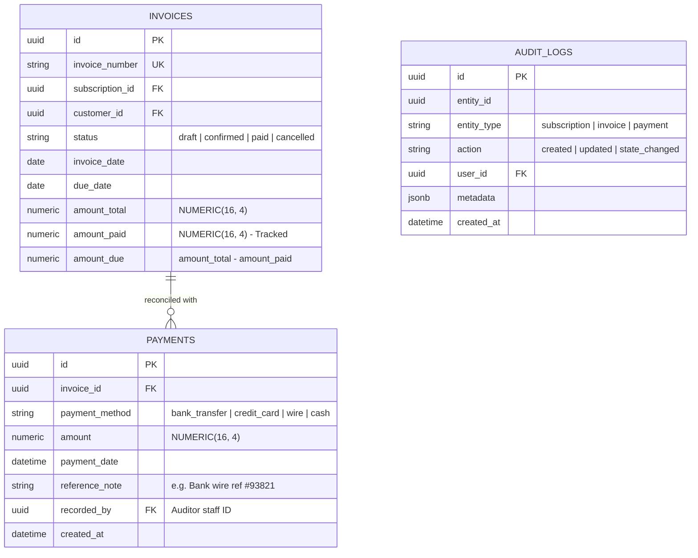
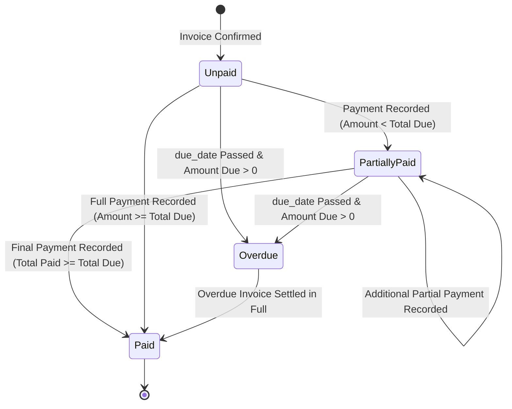

# 📊 PRD PHASE 3: Payments, Reconciliation, Dashboard & Executive Analytics (<2s SLA)
## Brightloop Software Subscription Billing Platform (Hackathon Winning Blueprint)

> **Document Version:** 1.0.0 (Production Engineering Specification)  
> **Engineering Mode:** GRAVITAS Invariant-Enforced Implementation  
> **Target SLA:** Dashboard Response Time $< 2.0$ Seconds at 10,000+ Subscriptions Scale  
> **Phase Scope:** Payments, Partial Settlement, Overdue Aging, Real-Time Financial Dashboard, End-to-End Test Suite  

---

## 1. Executive Context & Phase Objective

Phase 3 completes the financial feedback loop for Brightloop Software. It solves the manual bank-statement scrolling nightmare, automates payment-to-invoice reconciliation (including partial payments), tracks aging overdue receivables, and provides the Finance Lead with instantaneous (<2 seconds) answers to critical financial KPIs: Normalized MRR, Projected ARR, Cash Flow, and Churn.

### Core Deliverables in Phase 3
1. **Multi-Method Payment Recording & Reconciliation:**
   - Methods: `bank_transfer`, `credit_card`, `wire_transfer`, `cash`, `upi`.
   - Recording metadata: Method, amount, payment timestamp, reference note, recorded-by auditor ID.
   - Partial payment support: Automatic reconciliation tracking (`amount_paid` and `amount_due`). State transitions to `paid` only when $\text{amount\_paid} \ge \text{amount\_total}$.
2. **Aged Receivables & Overdue Dunning Tracking:**
   - Real-time classification of unpaid invoices past `due_date`:
     - Bucket 1: 1–30 Days Overdue
     - Bucket 2: 31–60 Days Overdue
     - Bucket 3: 61–90 Days Overdue
     - Bucket 4: 90+ Days Overdue (High Risk / Bad Debt)
3. **High-Performance Executive Financial Dashboard (<2s SLA):**
   - Normalized MRR Formula (Daily, Weekly, Monthly, Yearly normalized to 30.4375-day standard).
   - Projected ARR ($\text{MRR} \times 12$).
   - Total Active Contracts vs Churned Contracts.
   - Cash Collected This Month vs Total Outstanding Debt.
   - Covered composite indexes guaranteeing $< 200\text{ms}$ query execution across 10,000+ subscriptions.
4. **Customer Self-Service Portal:**
   - Tenant-isolated view (`WHERE customer_id = authenticated_user.id`).
   - Customers view active contracts, renewal dates, and download payment receipts / PDF invoices.
5. **Gravitas Automated Test Harness & Verification Suite:**
   - Concurrency stress tests.
   - Idempotency validation tests.
   - Financial calculation precision tests.

---

## 2. Technical Architecture & Data Models (Phase 3)

### 2.1 Entity Relationship Diagram (Phase 3 Sub-schema)



---

## 3. Financial Analytics & Dashboard Optimization (<2s SLA)

### 3.1 Normalized MRR Mathematical Formulation
Subscriptions come in Daily, Weekly, Monthly, and Yearly intervals. To display a true Monthly Recurring Revenue figure, the query mathematically normalizes each cadence:
$$\text{Line Subtotal} = \text{Line.quantity} \times \text{Line.unit\_price}$$

$$\text{Normalized Monthly Factor} = 
\begin{cases} 
30.4375 & \text{if interval = 'daily'} \\
4.348 & \text{if interval = 'weekly'} \\
\frac{1}{\text{interval\_count}} & \text{if interval = 'monthly'} \\
\frac{1}{12 \times \text{interval\_count}} & \text{if interval = 'yearly'} 
\end{cases}$$

$$\mathbf{MRR} = \sum (\text{Line Subtotal} \times \text{Normalized Monthly Factor})$$
$$\mathbf{ARR} = \mathbf{MRR} \times 12$$

### 3.2 Database Indexing Strategy (Sub-Second Latency)
To guarantee the $<2.0\text{s}$ SLA with 10,000+ active subscriptions:

```sql
-- 1. Index for Subscriptions MRR calculation (Covering Index)
CREATE INDEX idx_perf_sub_mrr ON subscriptions(state, plan_id) 
INCLUDE (id, customer_id);

-- 2. Index for Invoice Aging & Overdue calculations
CREATE INDEX idx_perf_invoice_aging ON invoices(status, due_date) 
INCLUDE (id, customer_id, amount_total, amount_paid);

-- 3. Index for Cash Collections summary
CREATE INDEX idx_perf_payments_cash ON payments(payment_date) 
INCLUDE (amount, payment_method);
```

### 3.3 Optimized Dashboard Aggregation Query (Single-Pass SQL)
Instead of firing 10 separate queries from the API, the executive dashboard queries are aggregated into a single high-speed JSON projection:

```sql
WITH mrr_calc AS (
    SELECT 
        ROUND(SUM(
            CASE 
                WHEN bp.interval_unit = 'daily'   THEN (sl.quantity * sl.unit_price) * 30.4375
                WHEN bp.interval_unit = 'weekly'  THEN (sl.quantity * sl.unit_price) * 4.348
                WHEN bp.interval_unit = 'monthly' THEN (sl.quantity * sl.unit_price) / bp.interval_count
                WHEN bp.interval_unit = 'yearly'  THEN (sl.quantity * sl.unit_price) / (12 * bp.interval_count)
                ELSE 0 
            END
        ), 2) AS total_mrr,
        COUNT(DISTINCT s.id) AS active_subscriptions_count
    FROM subscriptions s
    JOIN billing_plans bp ON s.plan_id = bp.id
    JOIN subscription_lines sl ON sl.subscription_id = s.id
    WHERE s.state = 'active'
),
aging_calc AS (
    SELECT 
        COALESCE(SUM(CASE WHEN CURRENT_DATE - due_date BETWEEN 1 AND 30 THEN (amount_total - amount_paid) ELSE 0 END), 0) AS overdue_1_30,
        COALESCE(SUM(CASE WHEN CURRENT_DATE - due_date BETWEEN 31 AND 60 THEN (amount_total - amount_paid) ELSE 0 END), 0) AS overdue_31_60,
        COALESCE(SUM(CASE WHEN CURRENT_DATE - due_date BETWEEN 61 AND 90 THEN (amount_total - amount_paid) ELSE 0 END), 0) AS overdue_61_90,
        COALESCE(SUM(CASE WHEN CURRENT_DATE - due_date > 90 THEN (amount_total - amount_paid) ELSE 0 END), 0) AS overdue_90_plus,
        COALESCE(SUM(amount_total - amount_paid), 0) AS total_receivables
    FROM invoices 
    WHERE status = 'confirmed' AND due_date < CURRENT_DATE
),
cash_calc AS (
    SELECT 
        COALESCE(SUM(amount), 0) AS cash_collected_this_month
    FROM payments 
    WHERE payment_date >= date_trunc('month', CURRENT_DATE)
)
SELECT 
    mrr_calc.total_mrr,
    (mrr_calc.total_mrr * 12) AS projected_arr,
    mrr_calc.active_subscriptions_count,
    aging_calc.overdue_1_30,
    aging_calc.overdue_31_60,
    aging_calc.overdue_61_90,
    aging_calc.overdue_90_plus,
    aging_calc.total_receivables,
    cash_calc.cash_collected_this_month
FROM mrr_calc, aging_calc, cash_calc;
```

---

## 4. Payment Reconciliation & Settlement State Machine



### 4.1 Payment Allocation Rules
1. When a payment of amount $P$ is recorded against Invoice $I$:
   - Record `payments` row with timestamp, payment method, reference note, and auditor ID.
   - Atomically increment `invoices.amount_paid = invoices.amount_paid + P`.
   - If $\text{invoices.amount\_paid} \ge \text{invoices.amount\_total}$:
     - Update `invoices.status = 'paid'`.
   - If $0 < \text{invoices.amount\_paid} < \text{invoices.amount\_total}$:
     - Set tracking status to `partially_paid`.

---

## 5. API Endpoints Specification (Phase 3)

| Method | Endpoint | Allowed Roles | Description |
| :--- | :--- | :--- | :--- |
| `POST` | `/api/invoices/{id}/payments` | Staff, Admin | Record payment (supports partial payment & audit reference). |
| `GET` | `/api/invoices/{id}/payments` | Staff, Admin, Customer | List all payments allocated to this invoice. |
| `GET` | `/api/reports/dashboard` | Admin, Staff | Get executive dashboard KPIs (MRR, ARR, Aging, Cash) with $<2$s SLA. |
| `GET` | `/api/reports/overdue-invoices` | Admin, Staff | Get filtered list of overdue invoices with customer contact details. |
| `GET` | `/api/portal/my-subscriptions` | Customer Portal | View customer's own active and historical subscriptions. |
| `GET` | `/api/portal/my-invoices` | Customer Portal | View and download customer's own invoices and payment receipts. |

---

## 6. Acceptance Criteria & Gravitas Verification Contract (Phase 3)

- [ ] **AC-3.1:** Recording a partial payment of $500 on a $1,000 invoice keeps the invoice in `confirmed` status with `amount_due = 500`.
- [ ] **AC-3.2:** Recording a second payment of $500 on the same invoice automatically transitions its status to `paid`.
- [ ] **AC-3.3:** Unpaid invoices past their `due_date` are correctly categorized into the 1–30, 31–60, 61–90, or 90+ day aging buckets.
- [ ] **AC-3.4:** Customer portal endpoint returns only the authenticated customer's records; attempting to query another customer's invoice ID returns HTTP 403 Forbidden.
- [ ] **AC-3.5:** Executive dashboard query executes in $< 200\text{ms}$ on a database seeded with 10,000 active subscriptions and 50,000 invoices.

---
*Signed off for Phase 3 Implementation.*
