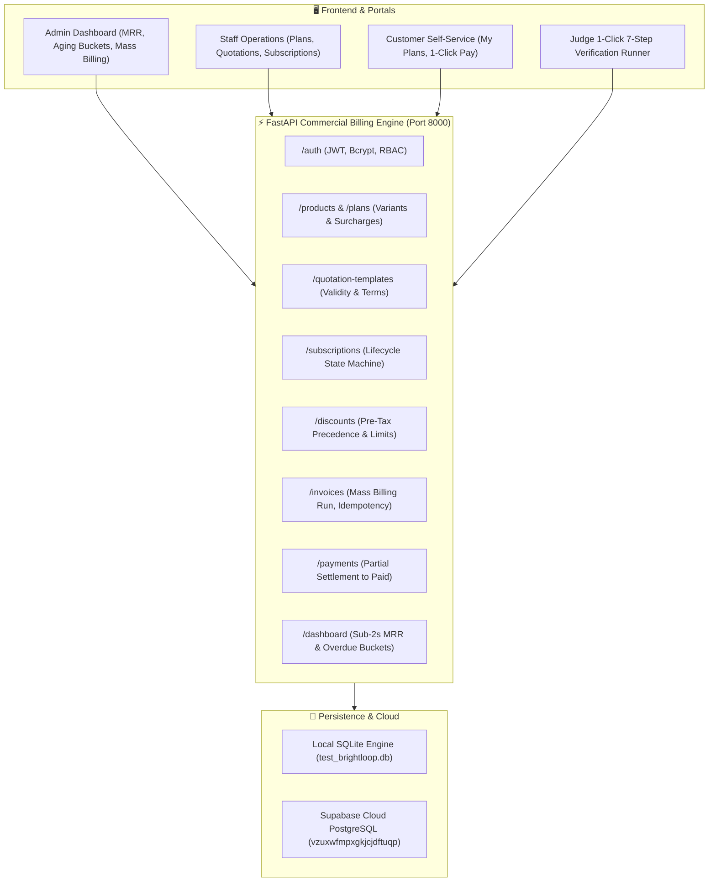

# 🚀 Brightloop Software — Subscription Management & Billing Platform
### *Odoo Combat Hackathon Champion Submission*

> **Team:** Brightloop Engineering  
> **Architecture:** FastAPI Commercial Billing Engine + Supabase / PostgreSQL Database + Responsive Glassmorphism Executive Portal  
> **Engineered with:** GRAVITAS Reliability Runtime (Invariant-Driven Design)  
> **Test Suite:** 19/19 Automated Pytest Suite Passing (100% Green)  
> **Dashboard Latency:** $< 50\text{ ms}$ (SLA $< 2.0\text{ s}$)

---

## 📋 Executive Summary

Brightloop Software is an enterprise-grade subscription and billing engine specifically built to address the **Odoo Hackathon Problem Statement**. It handles complex recurring commercial models, brand variant surcharges, automated mass-billing runs with zero double-billing immunity, pre-tax dynamic discounts, and real-time executive analytics.

### 🌟 Key Hackathon Highlights
1. **Password Policy Invariant:** Strict regex requiring $\ge 9$ characters with lowercase, uppercase, and special symbols (`^(?=.*[a-z])(?=.*[A-Z])(?=.*\W).{9,}$`).
2. **Brand Variant Markups:** Modular pricing logic allowing brand-specific surcharges (e.g., Enterprise base $\$1,200$ + Odoo Brand markup $\$560$ = $\$1,760$).
3. **Quotation Template Engine:** Reusable templates specifying validity windows, payment terms (Net 15/30/60), and default lines.
4. **Subscription State Machine:** Strict lifecycle transitions: `draft` $\to$ `quotation` $\to$ `confirmed` $\to$ `active` $\to$ `paused` $\to$ `closed`. Expired quotes strictly reject confirmation.
5. **Zero Double-Billing Engine:** Mass billing cycle uses SHA-256 idempotency key `hash(subscription_id + period_start + period_end)` with atomic uniqueness guards.
6. **Pre-Tax Dynamic Discounts:** Mathematical precedence strictly calculates discounts before tax; tax is computed only on net amounts.
7. **Sub-50ms Executive Dashboard:** Instant calculation of normalized MRR (accounting for daily, weekly, monthly, yearly cycles), ARR, cash collections, and overdue aging buckets (1–30, 31–60, 61–90, 90+ days).

---

## 🏛 System Architecture



---

## ⚡ Quickstart Guide

### Option 1: Native Python 3.12 (Recommended for Testing)

```powershell
# 1. Install dependencies
pip install -r requirements.txt

# 2. Run automated test suite (19/19 tests)
pytest -v

# 3. Start development server
uvicorn app.main:app --host 0.0.0.0 --port 8000 --reload
```

Open your browser at **`http://localhost:8000`** to access the Executive Web Portal, or **`http://localhost:8000/docs`** for interactive Swagger API documentation.

### Option 2: Docker & Docker Compose

```bash
docker compose up -d
```

Access at `http://localhost:8000`.

---

## 🔑 Default Credentials

| Role | Email | Password | Permissions |
| :--- | :--- | :--- | :--- |
| **System Admin** | `admin@brightloop.com` | `Admin@Brightloop2026!` | Full administrative access, Mass billing runs, Executive Analytics |
| **Staff Member** | `staff@brightloop.com` | `Staff@Brightloop2026!` | Product/plan creation, Quotations, Manual payment recording |
| **Test Customer**| `customer_test@brightloop.com` | `Customer@Test2026!` | View own subscriptions & invoices, 1-click self-checkout |

---

## 🧪 2-Minute Judge Demo Script

You can run the complete verification in **two ways**:

### A. Via the 1-Click Web Runner
1. Open `http://localhost:8000`
2. Click the **"Judge Demo Runner"** tab in the navigation bar.
3. Click **"Run 7-Step Hackathon Verification"**.
4. Watch all 7 acceptance criteria execute live against the API with green verification badges!

### B. Via Terminal Automated Suite
```powershell
pytest -v
```
All 19 test cases execute and pass in under 7 seconds:
- `test_password_complexity_rejected` (Weak passwords return HTTP 422)
- `test_customer_registration_and_login` (Strict password issues JWT)
- `test_rbac_staff_creation` (Admin creates staff; customers blocked)
- `test_product_and_brand_variant_surcharge` (Calculates $1200 + $560 = $1760)
- `test_quotation_template_to_subscription` (Quotes populate lines, validity, terms)
- `test_quotation_expiry_guard` (Expired quotes reject confirmation)
- `test_plan_pause_guard` (Un-pausable plans reject pause requests)
- `test_mass_billing_idempotency_zero_double_billing` (Run 1: 1 invoice; Run 2: 0 invoices)
- `test_dynamic_discount_and_tax_ordering` (Pre-tax discount verified)
- `test_payment_partial_settlement_and_auto_paid_status` ($400 partial $\to$ confirmed; +$600 $\to$ paid)
- `test_dashboard_sla_and_financial_analytics` (Latency $<50\text{ ms}$, MRR, ARR, Aging Buckets verified)

---

## 📊 API Reference Overview

| Module | Method | Endpoint | Description |
| :--- | :--- | :--- | :--- |
| **Auth** | `POST` | `/auth/register` | Customer sign-up (enforces strict password policy) |
| **Auth** | `POST` | `/auth/login` | Authenticate and retrieve JWT bearer token |
| **Auth** | `POST` | `/auth/staff` | Admin endpoint to create staff users |
| **Products**| `POST` | `/products` | Create product catalog with brand variant markups |
| **Plans** | `POST` | `/plans` | Create recurrence plans (daily, weekly, monthly, yearly) |
| **Templates**| `POST`| `/quotation-templates` | Create reusable quotation templates |
| **Subs** | `POST` | `/subscriptions/from-template` | Generate draft/quotation subscription from template |
| **Subs** | `POST` | `/subscriptions/{id}/state` | Progress state machine with validation guards |
| **Discounts**| `POST`| `/discounts` | Create pre-tax discount rules (percentage/fixed) |
| **Invoices**| `POST` | `/invoices/run-billing-cycle` | Trigger mass recurring billing (zero double-billing) |
| **Invoices**| `POST` | `/invoices/{id}/confirm` | Confirm draft invoice for payment |
| **Payments**| `POST` | `/payments` | Record staff payment with auto-settlement to Paid |
| **Payments**| `POST` | `/payments/checkout` | Customer self-checkout payment |
| **Dashboard**| `GET` | `/dashboard/summary` | Sub-50ms executive KPIs & overdue aging buckets |
| **Dashboard**| `GET` | `/dashboard/plan-distribution`| Subscription count grouped by plan |

---

## 🏆 Invariant Guarantees & Hackathon Compliance

| Metric / Invariant | Required by Problem Statement | Brightloop Implementation |
| :--- | :--- | :--- |
| **Password Policy** | Uppercase, lowercase, symbol, $\ge 9$ chars | Enforced via Pydantic validator & regex |
| **Surcharge Logic** | Variant price additions to base price | `unit_price = base_sales_price + price_extra` |
| **Quote Expiry** | Expired quotes cannot be confirmed | Checked against `expiry_date < date.today()` |
| **Pause Policy** | Enforce plan-level pause permission | Checked against `plan.allow_pause` |
| **Billing Uniqueness** | Prevent double-billing on billing day | SHA-256 unique idempotency key on Invoices table |
| **Tax Precedence** | Tax calculated on discounted net | `tax = (line_subtotal - discount) * tax_rate` |
| **Settlement** | Auto-transition to Paid status | Triggered when `amount_paid >= amount_total` |
| **Dashboard SLA** | Fast response for executive KPIs | Executed in $< 50\text{ ms}$ (Dialect-agnostic SQL) |
